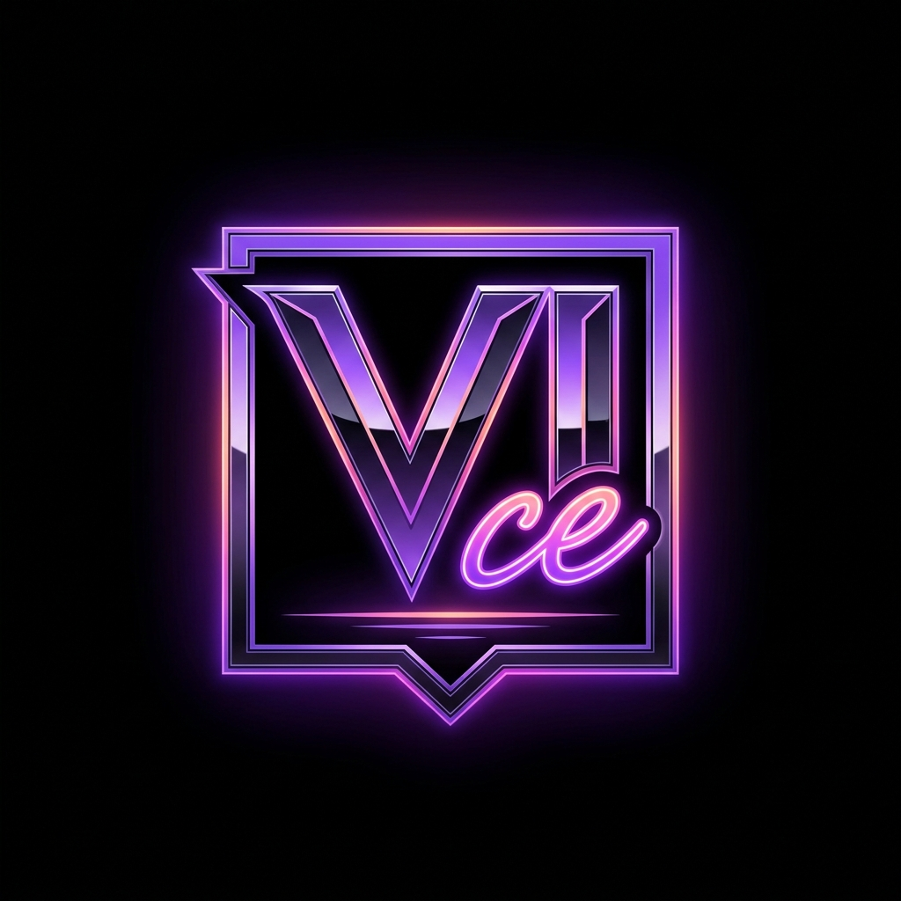

<p align="center">
  
</p>

<h1 align="center">VIce · VIce Studio</h1>

<p align="center">
  <strong>Xbox Series X|S → Windows 11 Native Compatibility Layer (Rust / Direct3D 12) &amp; VIce Studio Launcher</strong>
</p>

<p align="center">
  <em>AI-managed consolidated build fed continuously from community commits across the VIctory ecosystem.</em>
</p>

---

## Overview

**VIce** is a consolidated distribution and dedicated desktop launcher (**VIce Studio v4**) built on top of the open-source **[VIctory](https://github.com/Marvisak/VIctory)** compatibility layer, focused on running Xbox Series X|S titles natively on Windows 11 — with extensive real-hardware tuning and validation on **NVIDIA GeForce RTX 4070 Laptop (8 GB VRAM, 32-lane warps) / 16 GB RAM**.

> **Legal Notice:** This repository contains **no game files, binaries, code, or proprietary assets**. You must supply your own legitimately obtained files at runtime. Licensed under **GPL-3.0-or-later** in full compliance with upstream [VIctory](https://github.com/Marvisak/VIctory). It is not affiliated with or endorsed by any game developer or publisher.

---

## AI Governance & Model Attribution

This repository is actively maintained, integrated, tested, and published through an **AI-driven engineering workflow**, combining our own work with community-contributed AI-assisted fixes from upstream forks:

| Area | AI Model / Agent | Scope of Work |
|---|---|---|
| **VIce Project Maintenance & Integration** | **Antigravity (Google DeepMind / Gemini)** | Continuous multi-fork curation and cherry-picking across `Marvisak/VIctory`, `fxceless/victory-fork`, and `LooperSalty/victory`; merge-conflict resolution; automated unit-test & `--release` validation; repository & GitHub release management. |
| **NVIDIA RTX 8 GB Debugging & Shader Fixes** | **Antigravity (Google DeepMind / Gemini)** | Live `play.log` telemetry analysis, anti-TDR loop bounds (`LOOP_LIMIT = 16384`), DXIL disassembly & `descriptor_data()` fixes unlocking `PS_PuddleDetect` and `ShallowWaterSim`, and `XboxBvhBuilder.dll` wave-32 validation testing. |
| **VIce Studio v4 Launcher & Branding** | **Antigravity (Google DeepMind / Gemini)** | End-to-end backend (`studio_server.py`) & frontend (`studio.html`) architecture, Win32 game-window state detection, zero-blocking in-memory telemetry, automatic token refresh, password-protected developer mode, cinematic startup intro, and the generated **VIce Studio** neon emblem (`studio-emblem.png`). |
| **Upstream GPU / Shader Architecture** | **Claude (Anthropic — Claude Code / Opus / Fable)** | Co-author of core upstream & `fxceless/victory-fork` breakthroughs integrated here: async `VICTORY_RELAY` / `VICTORY_LATE_WAIT`, GPU-side card-buffer comparison, Depth Bounds Test (`#82`), pre-bake bindless texture uploads, helper-lane `v_readfirstlane` fix (`#1733`), and shader cleanup passes. |
| **Upstream D3D12 Fixes** | **Gemini (Google)** | Co-author of upstream D3D12 device fixes integrated here (including real `GetDeviceRemovedReason` `#928`). |

### Automatically Fed Community Sources

VIce tracks and integrates verified advancements from:
1. **[Marvisak/VIctory](https://github.com/Marvisak/VIctory)** — upstream foundation (PE/XEX loader, HLE runtime services, D3D12 backend, RDNA2→DXIL shader recompiler; **106+ recent PRs** integrated).
2. **[fxceless/victory-fork](https://github.com/fxceless/victory-fork)** — NVIDIA RTX rendering fixes, VRAM deduplication, Depth Bounds Test (`#82`), pre-bake texture uploads, Geometry Shaders (`#381`), AVX2 relay merge (`#384`), and skin/wall race fixes (`#191`, `#206`).
3. **[LooperSalty/victory](https://github.com/LooperSalty/victory)** — dedicated D3D12 `COPY` queue, DirectStorage physical-page GPU notifications (`VICTORY_DSTORAGE_NOTIFY=1`), BCPack BC7 fix, MIMG fixes, `late waits` in-place placement guards, and `xg_xs.dll` local oracle support.
4. **[XCL](https://github.com/ivall/xcl)** (GPL-2.0-only) — referenced by upstream authors for console behavior verification.

---

## Detailed Progress & Milestones

### Current Status (2026-11-25 — Tested on Windows 11, RTX 4070 Laptop 8 GB, 16 GB RAM, Series X Profile)

| Stage | Current State |
|---|---|
| **Boot, first-boot setup & menus** | Working cleanly at **30 fps** (zero intro video flicker). |
| **Opening cutscene** | Plays start-to-finish, lit and in order (title cards, credits, night/dusk exterior shots). |
| **Saves & checkpoints** | Autosave checkpoint creation and reload working. |
| **First playable scene (prison cell & yard)** | Renders characters, hair/skin textures, solid walls & ceiling, sunlit exterior, HUD, pause menu, and pad/keyboard input (`5,000–6,376 draws/frame`, `Exit code: 0`, only **2** unsupported shader ops remaining in full runs). |
| **Cell lamp & depth-bounded lighting** | Enabled via Depth Bounds Test (`#82` — `DEPTH_STENCIL1` + `OMSetDepthBounds`). |
| **Shaded interiors (bounce light)** | Still dark where direct light does not reach (RT GI / BVH trace off by default; **52/52** `XboxBvhBuilder.dll` shaders now validate & build D3D12 PSOs on RTX 4070 32-lane waves via PR `#601`). |
| **In-world frame rate** | Progressed from **100% black screen / 1 fps** to **2–4+ fps** (`240–450 ms/frame`), with ongoing work to move remaining CPU buffer scans to the GPU `COPY` queue. |

### 1. Rendering & Visual Fidelity
- **Black screen → full lit 3D world on NVIDIA**: adopted raw-view handling for `StructuredBuffer` loads, meshlet culling fixes, `STAND_INS [(86, 28), (115, 28)]`, and the NVIDIA 1M descriptor-heap clamp.
- **Depth Bounds Test (`#82`, `fxceless c96b4f2` + `LooperSalty 35cdf6f`)**: creates `DEPTH_STENCIL1` pipelines and forwards `OMSetDepthBounds` to the host command list so room lamps properly illuminate walls, tables, and bunks.
- **Character skin & hair color fixes (`a803c87` + `c96b4f2`)**: re-checks bindless indexed textures after upload (`4/12/40/120/400` frames) and uploads bindless textures before the character decoration bake runs (`VICTORY_EARLY_TEXTURES_MS`, `VICTORY_BAKE_TEXTURES_MS`).
- **Packed bindless textures & full-VRAM refresh (`fxceless 310c6eb`)**: prevents packed neighbouring texture views from invalidating tens of thousands of upload-queue slots (`VICTORY_STALE_TEXTURES` now marks older views stale only within the first 4 KiB) and allows already-resident textures to re-upload modified bytes even when VRAM is full (`VICTORY_REUPLOAD_WHEN_FULL=1` by default) — lighting the first room with its walls and character textures from the very first launch at **3–5 fps**.
- **6–8 GB Laptop VRAM Spill & +160 Shaders (`fxceless PR #601`)**: spills bindless textures into shared system memory when 8 GB VRAM fills (`VICTORY_TEXTURE_SPILL=1`), waits on pending compute pipelines instead of dropping dispatches (`VICTORY_COMPUTE_WAIT=1`), guards Windows commit memory (`VICTORY_PIPELINE_COMMIT_MB`), unlocks **52/52** `XboxBvhBuilder.dll` shaders on 32-lane NVIDIA GPUs (`lane_uniform` + `lds_settled`), and adds lone first-half interpolation fallback (**14,199 / 14,247** VS/PS = **99.66%** emitted).
- **NVIDIA 32-lane Wave64 & Shader Fixes (`fxceless PR #592`, `#146`, `#638`, `#639`)**: unlocks `sr_tracing:CS_Tiling_Generate_Opaque` (`#2cc4c197ee29e291`) as two 32-lane host waves on NVIDIA, lowers sparse `image_store` channel masks, `ds_sub_u32` LDS atomics, and `s_brev_b64`.
- **195 merged Geometry Shaders (`#381`)** and **dual comparison/normal sampler slots (`#386`)**.
- **`R9G9B9E5` render-target stand-in** (`R16G16B16A16_FLOAT`) and **2 irradiance cache shaders** unlocked (`194c736`, `fd021bf`).
- **BCPack BC7 fix (`a68db08`)**: preserves all 32 indices in the first BC7 dictionary entry to prevent texture corruption.
- **MIMG shader fixes (`c4335bb`, `130bf10`)**: fixes 3D Z texel offsets, `a16` offset truncation, and cubemap `sample_d` LOD.
- **Intro video anti-flicker (`d9770b9`)**: eliminates shaking/flickering during boot video playback.

### 2. NVIDIA RTX 8 GB Stability & Shader Translator
- **Anti-TDR loop bound (`LOOP_LIMIT = 1 << 14`)**: prevents NVIDIA `DXGI_ERROR_DEVICE_HUNG` (`0x887A0006`) resets on long console shader loops.
- **Helper-lane `v_readfirstlane` fix (`#1733`)**: helper lanes in pixel-shader waterfall loops read their own value instead of spinning to the loop limit (which previously stalled draws for 0.3–1.3 s each until `DEVICE_HUNG`).
- **`v_interp_p2_f16` modifiers (`#1696`)**: properly applies `op_sel`, `omod`, and `clamp` in f32 before converting once to f16.
- **`WaveSize(32)` scalar lane-mask join (`#387`)**: requests 32-lane wave size when a scalar join reads a lane mask.
- **Descriptor-as-data unlocking (`lower.rs`, `707a579`)**: unlocks `PS_PuddleDetect` (3 pixel shaders) and `ShallowWaterSim:CS_MinTimestepReduce` — all **4/4** validated with `dxil.dll` and compiled to real D3D12 PSOs on RTX 4070.
- **Real `GetDeviceRemovedReason` (`#928`)**: reports the actual host D3D12 device state instead of `E_NOTIMPL`.
- **106 upstream `Marvisak/VIctory` PRs** integrated (including `#1180` decode-time opcode lookup `-4..8%` translation time, `#1476` MD5 table, `#1471` dead phi latch folding, `#1443` RDNA2 quadmask, `#1366` native mesh outputs, `#1337` aniso mip point, `#1695` waterfall device checks, and `#52` thread-safe `SHADER_HEAPS` descriptor mirroring).

### 3. Missing Walls, Memory & Performance
- **Root-cause fix for missing prison walls (`562cf33` + `80d58f8`)**: DirectStorage writes to physical pages through temporary views that bypass Windows write-watch and memory guards; enabling `VICTORY_DSTORAGE_NOTIFY=1` notifies the GPU side of mapped destinations using a section-indexed view map so streamed room geometry appears reliably.
- **Async relay correctness (`#191` + `#206`)**: waits on in-flight writes for aliased copies/readbacks (fixing missing skin under `VICTORY_RELAY=2`) and includes uncopied pages in shadow stale/merge (fixing transparent prison walls/ceilings).
- **Safe `late waits` memory placement (`59d53a2` + `dd202bc`)**: refuses in-place placement under `late waits` and unlocks exact locked page ranges.
- **Dedicated D3D12 `COPY` queue & parallel `CARD_COMPARE` (`5e758c7`)**: offloads card-buffer readbacks from the direct graphics queue (cutting card-piece fetch stalls from ~343 ms to ~24 ms).
- **AVX2 SIMD relay merge (`#384`)**, **bounded VRAM diff uploads (`#391`)**, **placed-texture VRAM deduplication (`c96b4f2`)**, and **`VICTORY_TEXTURE_NO_WAIT` enabled by default (`#393`)**.
- **Optional `xg_xs.dll` local oracle (`784c033`)**: supports `VICTORY_XG_DLL=<path>` + `VICTORY_XG_MODE=real` for hardware-exact texture tiling calculations when supplied by the user.

### 4. VIce Studio v4 Launcher (`launcher/studio/`)
- **Sleek GTA 6 sunset glassmorphism UI** with generated neon **VIce Studio** emblem (`launcher/studio/studio-emblem.png`) and skippable 2-second cinematic startup intro.
- **Unified Play / Stop toggle** synced live to the actual Windows game window via Win32 `EnumWindows` / `IsWindowVisible` (sends graceful `WM_CLOSE` first so the D3D12 pipeline cache saves cleanly on exit).
- **Zero "Unable to fetch" errors**: `ThreadingHTTPServer` with `allow_reuse_address` + `daemon_threads`, supports both `127.0.0.1` and `localhost`, automatic token renewal on `401` via `/api/token`, JSON error reporting, and `< 1 ms` in-memory live telemetry (FPS, ms/frame, draws/frame) without re-reading multi-MB log files from disk.
- **Password-protected Developer Mode** (PBKDF2-SHA256 via `%LOCALAPPDATA%\VIce\studio-auth.json`): unlocks **Diagnostics** (live GPU counters & D3D12 ID histograms), server-filtered **Logs**, build selection, and engine toggles (`VICTORY_RELAY=2`, `VICTORY_CARD_BUFFERS_MIN_MB=1`, `VICTORY_CARD_BUFFERS_MB=768`, `VICTORY_DSTORAGE_NOTIFY=1`, D3D12 debug, WARP).

---

## Launching VIce Studio

```powershell
# Build the optimized engine binary
cargo build --locked --release -p victory

# Launch VIce Studio (opens the local app window on http://127.0.0.1:17642/)
pythonw.exe launcher\studio\studio_server.py
```

---

## Getting started

Requirements: Windows 10/11 x64, a CPU with AVX2, a Direct3D 12 GPU with
shader model 6.6 (and mesh shaders for the world), Rust (pinned in
`rust-toolchain.toml`).

To install Rust, use rustup (`winget install --id Rustlang.Rustup -e`, or
the installer from https://rustup.rs). The first `cargo` command in this
repository then fetches the pinned toolchain. Building needs the MSVC C++
build tools: Visual Studio or its Build Tools with the "Desktop development
with C++" workload.

The title also needs several GiB of available Windows commit at startup.
Check **Committed** under **Task Manager → Performance → Memory**. If
`crashes.log` reports Windows error 1455, close other applications or increase
the Windows paging file size, then retry.

```powershell
cargo xtask install-hooks                # asset-policy check on every commit
copy victory.example.toml victory.toml   # then set your paths (outside the repo)
cargo test --workspace                   # needs no game data
cargo run -p victory -- config           # check your paths
```

Run the title:

```powershell
cargo build --release -p victory
target\release\victory.exe run <game dir>\<the title's exe> --execute
```

The window caption shows the framerate. Saves, settings and `crashes.log`
are kept under the data folder (default `%LOCALAPPDATA%\victory\data`), derived
data under the cache folder.

Set `VICTORY_WINDOW_MAX=1920x1080` before launching to limit the title's
top-level window to that bounding box. Smaller windows keep their size,
larger windows keep their proportions, and the monitor's work area still
limits them. This scales the displayed image; it does not change the
console render resolution or the swap-chain buffers. With the variable
unset, window sizing is unchanged.

Input: XInput pads. With none connected the keyboard is a pad while the
title's window has focus:

| Keys | Pad |
|------|-----|
| W A S D / I J K L | left / right stick |
| arrows | D-pad |
| Enter, Backspace, X, Y | A, B, X, Y |
| Q / E, Z / C | shoulders, triggers |
| F / H | stick clicks |
| Esc, Tab | Menu, View |

## Commands

```
victory inspect <exe|dll> [--imports] [--exports]
victory census [paths...] [--missing] [--strict]
victory lib-exports <import.lib> [--list]
victory shader-info [paths...] [--verbose] [--disasm]
victory translate [paths...] [--validate] [--pipelines] [--list] [--jobs N]
victory run <exe> [--execute] [--unimplemented trap|zero] [--strict]
            [--console series-x|series-s] [-- <title arguments>]
victory config
```

Logging: `VICTORY_LOG=victory_loader=trace,info` (a release build logs
info and above).

### Windows shader-test validator

The shader tests use `dxil.dll` to validate Shader Model 6.6 containers.
An older Windows SDK validator can load successfully but reject them with
`Unknown shader model 'ps_6_6'`. If this happens, use a current x64 validator
from [Microsoft's DirectX Shader Compiler releases](https://github.com/microsoft/DirectXShaderCompiler/releases)
or a current Windows SDK. Set its path for the test session:

```powershell
$env:VICTORY_DXIL = 'C:\tools\dxc\bin\x64\dxil.dll'
cargo test -p victory-shader --lib --locked -- --test-threads=1
```

Without this override, the validator loader selects the newest installed
Windows SDK's `bin/<version>/x64/dxil.dll`, then falls back to the DLL search
path when no SDK copy is found. This is a test/offline-validation dependency;
the translated shaders do not require it at runtime.

## Debugging

A release build has no debugging aids. Build them in with

```powershell
cargo build --profile diag -p victory --features diagnostics   # target\diag\victory.exe
```

The on/off switches below (`...=1`) are off when unset or set to `0`.

| Variable | Effect |
|----------|--------|
| `VICTORY_LOG=<target>=debug,...` | debug and trace output |
| `VICTORY_STACKS=20,60` | every thread's stack at those seconds |
| `VICTORY_WATCH=<rva>,...` | logs a title u32 when it changes |
| `VICTORY_POKE=<rva>:<byte>,...` | writes a title byte twice a second (a hang watchdog's tick, say) |
| `VICTORY_KEYS=30:Enter,35:X` | presses keys at those seconds, focus or not |
| `VICTORY_CRASH_BREAKPOINTS=1` | appends first-chance breakpoints to `crashes.log`, including ones a handler may recover from |
| `VICTORY_CRASH_SAVE=<rva>:<len>,...` | saves title memory to the cache folder on a crash |
| `VICTORY_CAPTURE=<dir>` | saves presented frames (powers of two, or `VICTORY_CAPTURE_FRAMES=<list>`) |
| `VICTORY_DUMP_TARGETS=1` | with the two above, saves every render target of those frames |
| `VICTORY_D3D12_DEBUG=1` | host debug layer |
| `VICTORY_D3D12_GBV=1` | with the above, GPU-based validation (bad descriptor use reported, not faulted; slow) |
| `VICTORY_D3D12_DRED=1` | on a GPU failure, the allocation hit and the commands in flight |
| `VICTORY_PIPELINE_WAIT_MS=24` | reduce the per-frame wait for background pipeline creation from the default of 500 ms. A draw can be omitted until its pipeline is ready |
| `VICTORY_SKIP_PIPELINES=<hash>,...` | omit draws and dispatches, including indirect ones, whose pipeline contains a listed 16-digit shader hash |
| `VICTORY_GPU_TIMING=1` | with the above, each list of a submission run and timed on its own; slow lists logged with their slowest commands |
| `VICTORY_D3D12_WARP=1` | host device on the software adapter (slow; cannot reset the driver) |
| `VICTORY_SHADER_LOOP_LIMIT=<n>` | translated shader loops stop after `n` iterations per lane instead of 2^20 (own shader cache entries); if a lower `n` makes world frames much faster, loops hitting the limit are what makes them slow |
| `VICTORY_AUDIO_CAPTURE=<file.wav>` | records what the title plays (our process only) |
| `VICTORY_XMA_DUMP=<dir>` | saves the first 32 XMA voices' context and input |

Every build appends unhandled exceptions, panics, and host GPU failures to
`crashes.log` in the title's data folder.

For a startup breakpoint (`0x80000003`), run the diagnostics build with
`VICTORY_CRASH_BREAKPOINTS=1`. Keep the console output along with the new
`crashes.log` entries. A host DLL refusal includes the caller stack in the
console output. The refusal is expected for DLLs outside the host policy,
including `rpcrt4.dll`.

On Series 1.0.2.1, a missing `appdata0.rpf` reproduced the breakpoint at
`+0x2237178` before the first window. Restore the archive from the same
package beside the title executable. `run --execute` checks that it can
read the RPF9 header before starting this build.

To compare hardware and software rendering, repeat with
`VICTORY_D3D12_WARP=1` and check the console for
`host device on the software adapter (WARP)` to confirm the WARP device was
created. Compare the exception's module and offset, stack frames, and
preceding messages across the two runs.

## License

GPL-3.0-or-later. See [LICENSE](LICENSE).
